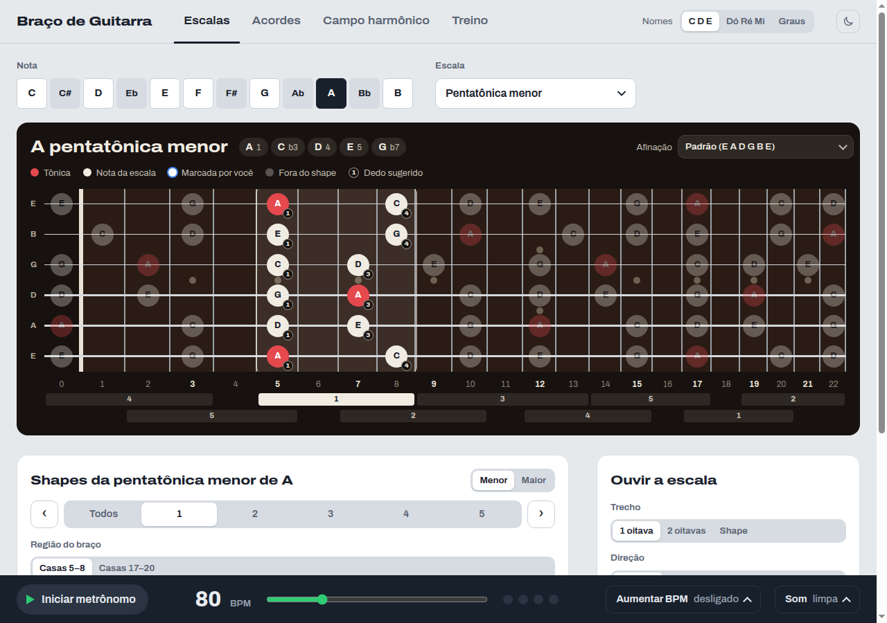

# Guitar Helper

Braço de guitarra interativo para visualizar escalas e acordes, descobrir notas e treinar, com metrônomo, trocas de acordes e a localização das notas no braço. Feito com HTML, CSS e JavaScript puros, sem dependências (a fonte Archivo vem do Google Fonts; sem internet, o navegador usa a fonte do sistema).

## Como usar

Abra o `index.html` no navegador. Não é preciso instalar nada nem rodar um servidor.

## Funcionalidades

O app tem três abas no topo: **Escalas**, **Acordes** e **Treino**. A tela é dividida sempre do mesmo jeito:

- **Topo:** as abas e a forma de ler os nomes das notas.
- **Escolha:** a nota e a escala ou o acorde. Durante o treino, dá lugar aos cartões Agora e Próximo.
- **Braço:** no centro, com o título do que está à mostra e a legenda.
- **Abaixo do braço:** o que complementa a aba, como as formas do acorde, a sequência do treino e as notas marcadas.
- **Rodapé:** o metrônomo, fixo e sempre ao alcance, em todas as abas.

As cores do braço têm sempre o mesmo significado: vermelho é a tônica, madrepérola é nota da escala ou do acorde, verde é a posição a tocar agora e azul é o que você marcou. O estudo que levou a essa organização está em [`docs/estudo-ux-ui.md`](docs/estudo-ux-ui.md).

### Escalas

Escolha uma das 12 notas e uma escala: maior, menores (natural, harmônica e melódica), pentatônicas, blues e modos. Também é possível mostrar todas as notas, só a nota escolhida ou nenhuma.

### Acordes

O braço mostra só as notas do acorde. São 18 tipos, entre tríades, suspensos, power chords, sétimas, sextas e nonas.

Abaixo do braço, **Formas** lista as variações tocáveis do acorde, com diagrama e cifra (`x-3-2-0-1-0`). Clique em uma para vê-la no braço, ou em "Todas as notas" para ver o acorde no braço inteiro. As variações são geradas automaticamente, sempre com a tônica no baixo.

### Treino

Escolha em **Treinar** o tipo de treino: troca de acordes ou notas no braço. A configuração fica no painel ao lado das formas, abaixo do braço. Os dois treinos funcionam do mesmo jeito:

- **Ordem:** sequencial ou aleatória. Na aleatória, o mesmo item nunca se repete em seguida.
- **Trocar a cada:** N loops ou N batidas.
- **Iniciar treino:** liga o metrônomo e mostra, logo acima do braço, dois cartões lado a lado: **Agora**, em verde, e **Próximo**, ligados por uma seta com uma barra que enche até a troca. Nos acordes, os dois cartões trazem o diagrama e a cifra.

As trocas seguem o metrônomo, inclusive o **Aumentar BPM**. Parar o metrônomo, ou atingir o BPM de **Parar em**, também encerra o treino.

#### Troca de acordes

1. Escolha a nota, o acorde e a forma, e clique em **Adicionar … à sequência**, no topo das formas. A sequência precisa de pelo menos 2 acordes.
2. Defina a ordem e a troca, e clique em **Iniciar treino**.

O braço mostra a forma a tocar, com o diagrama e a cifra do acorde atual.

#### Notas no braço

Treine a localização de uma nota em todo o braço:

1. Escolha a nota, por exemplo C. O braço mostra todas as posições dela, da corda solta à casa 22.
2. Defina a ordem e a troca, e clique em **Iniciar treino**.

Durante o treino, a posição a tocar agora fica destacada em verde no braço, e as demais posições da nota continuam visíveis. Os cartões mostram a casa e a corda (por exemplo, "Casa 3" e "Corda 5 (A)") da posição atual e da próxima, e a próxima posição também aparece no braço com um anel tracejado. Na ordem sequencial, as posições seguem da casa mais baixa para a mais alta e, na mesma casa, da corda mais grave para a mais aguda. Em telas pequenas, o braço rola sozinho até a posição destacada.

### Metrônomo

O metrônomo fica no rodapé. Escolha de 30 a 240 BPM e estude com clique em 4/4, com o primeiro tempo acentuado. O BPM pode ser alterado com o metrônomo tocando.

O botão **Aumentar BPM** abre as opções para o andamento subir sozinho e mostra a regra em uso (por exemplo, "+10 a cada 4 loops, até 120"). Cada loop é um compasso de 4 tempos.

| Opção | O que faz |
| --- | --- |
| Começar em | BPM de partida sempre que o metrônomo é iniciado |
| A cada | Quantos loops tocar antes de cada aumento |
| Somar | Quantos BPM aumentar de cada vez |
| Parar em | Opcional: toca o último ciclo nesse BPM e para, encerrando também o treino, se houver |

Por exemplo: começar em 80, somar 10 a cada 4 loops e parar em 120. Sem a opção **Parar em**, o aumento vai até 240 BPM e o metrônomo continua tocando.

### Exibição e seleção de notas

- **Nomes:** cifra (`C D E`), solfejo (`Dó Ré Mi`) ou graus (`1 b3 5`), no canto da barra superior.
- **Tema claro ou escuro:** o botão com a lua (ou o sol), no canto da barra superior, troca o tema. Sem escolha, o app segue o tema do sistema; depois de escolher, a escolha fica salva no navegador. No celular, o botão fica na linha das abas.
- **Notas marcadas:** clique em qualquer casa para marcar a nota, que ganha um anel azul. A lista abaixo do braço informa a posição, o grau e o nome equivalente (A# = Bb). Clique de novo para desmarcar.
- **Teclado:** use as setas para navegar pelas casas e Enter para marcar.

O braço tem cordas soltas e 22 casas, em afinação padrão, com a corda 1 (E aguda) no topo. Em telas pequenas, ele rola na horizontal.

## Estrutura

| Arquivo | Conteúdo |
| --- | --- |
| `index.html` | Estrutura da página |
| `style.css` | Estilos e tokens de cor dos temas claro e escuro |
| `script.js` | Teoria musical, geração das variações, montagem do braço, metrônomo e treino |
| `screenshot.png` | Captura de tela usada neste README |
| `docs/estudo-ux-ui.md` | Estudo de UX e UI: diagnóstico, proposta e capturas de antes e depois |

## Temas claro e escuro

Toda cor da interface é um token em `style.css`: o tema claro fica no `:root` e o escuro em `:root[data-theme="dark"]`, logo abaixo. O resto do CSS usa só `var(--token)`, nunca uma cor fixa. Ao criar uma feature que precise de uma cor nova, crie o token nos dois blocos e confira a tela nos dois temas. O braço é madeira escura nos dois temas, então as cores das notas sobre ele (`--on-pearl`, `--on-go`, `--on-tonic`, `--selected`) não mudam.
