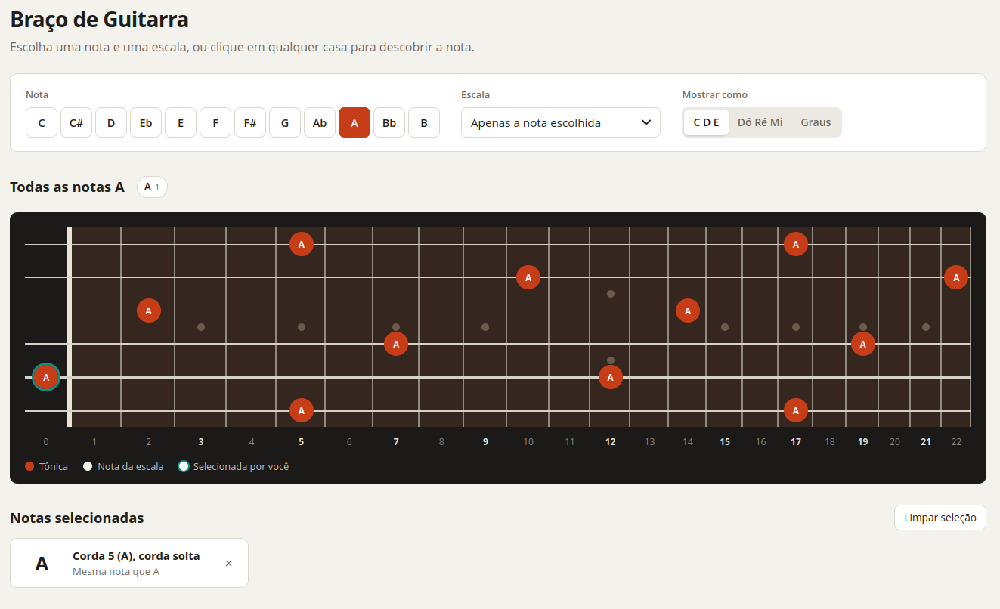

# Guitar Helper

Braço de guitarra interativo para visualizar escalas e acordes, descobrir notas e estudar com metrônomo. Feito com HTML, CSS e JavaScript puros, sem dependências.

## Como usar

Abra o `index.html` no navegador. Não é preciso instalar nada nem rodar um servidor.

## Funcionalidades

- **Nota e escala:** escolha uma das 12 notas e uma escala. Há maior, menores (natural, harmônica e melódica), pentatônicas, blues e modos. Também é possível mostrar todas as notas, só a nota escolhida ou nenhuma.
- **Acordes e variações:** no modo Acordes, o braço mostra só as notas do acorde. Há tríades, sétimas, sextas, nonas e power chords. Cada acorde lista variações tocáveis, com diagrama e cifra (`x-3-2-0-1-0`); clique em uma para vê-la no braço ou em "Todas as notas" para ver o acorde em todo o braço.
- **Metrônomo:** escolha de 30 a 240 BPM e estude com clique em 4/4, com o primeiro tempo acentuado. O BPM pode ser alterado com o metrônomo tocando. Também é possível aumentá-lo automaticamente: por exemplo, somar 10 BPM a cada 4 loops, sendo cada loop um compasso de 4 tempos. O aumento para em 240 BPM.
- **Formas de exibição:** cifra (`C D E`), solfejo (`Dó Ré Mi`) ou graus (`1 b3 5`).
- **Seleção manual:** clique em qualquer casa para ver a nota sobre a corda. Um cartão abaixo do braço informa a posição, o grau na escala e o nome equivalente (A# = Bb). Clique de novo para desmarcar.
- **Teclado:** use as setas para navegar pelas casas e Enter para selecionar.

O braço tem cordas soltas e 22 casas, em afinação padrão, com a corda 1 (E aguda) no topo. Em telas pequenas, ele rola na horizontal.

## Estrutura

| Arquivo | Conteúdo |
| --- | --- |
| `index.html` | Estrutura da página |
| `style.css` | Estilos |
| `script.js` | Teoria musical, montagem do braço e interação |
| `screenshot.png` | Captura de tela usada neste README |
