# Estudo de UX e UI

Estudo feito na branch `estudo-ux-ui` a partir da `main` (`823bf0b`). O pedido: o app tinha tudo junto na mesma tela, e a usabilidade estava confusa. O objetivo era dividir melhor as informações.

## Para quem e para quê

- **Quem usa:** alguém estudando guitarra, com o instrumento no colo e a tela a cerca de um metro. As mãos estão ocupadas, então cada clique e cada rolagem custam caro.
- **Tarefa principal:** ver no braço o que tocar, agora.
- **Tarefas de apoio:** escolher nota, escala ou acorde; montar e rodar um treino; ajustar o metrônomo; marcar notas para tirar dúvidas.

## Diagnóstico da versão anterior

### Medições

Posição do braço na primeira tela, sem rolar (medido com o mesmo script nas duas versões):

| Tela | Situação | Antes | Depois |
| --- | --- | --- | --- |
| Desktop 1280×900 | Escalas | 538–897 px, inteiro por 3 px | 177–552 px, inteiro |
| Desktop 1280×900 | Treino rodando | 628–987 px, **cortado** | 237–611 px, inteiro |
| Celular 390×844 | Escalas | 1009–1396 px, **fora da tela** | 334–716 px, inteiro |
| Celular 390×844 | Treino rodando | 1189–1577 px, **fora da tela** | 350–719 px, inteiro |

No celular, a página com o treino rodando tinha 1743 px de altura; agora tem 993 px.

### Problemas encontrados

1. **O braço não era o centro da página.** Ele vinha em quarto lugar, depois do cabeçalho, dos controles e do metrônomo. Durante o treino, ficava cortado no desktop e fora da tela no celular, justamente quando é preciso olhar para ele.
2. **Navegação e opções com o mesmo peso.** "Visualizar" (trocar de modo) tinha a mesma aparência de "Mostrar como" (preferência de leitura) e de "Ordem" e "Trocar por" (opções do treino). Não dava para saber o que muda a tela inteira e o que muda um detalhe.
3. **O metrônomo ocupava muito espaço.** Botão, BPM, régua, batidas e as cinco opções de "Aumentar BPM" ficavam sempre abertos, até na aba Escalas. No celular, eram cerca de 340 px antes do braço.
4. **O fluxo do treino de acordes ia e voltava.** O usuário escolhia a nota e o acorde em cima, a variação embaixo do braço e voltava para cima para clicar em "Adicionar". O próprio texto de ajuda pedia: "Escolha a nota, o acorde e a variação (abaixo do braço)".
5. **A tela mudava de forma ao iniciar o treino.** Alguns controles sumiam, o painel do treino mudava de altura e o braço descia.
6. **As notas marcadas ficavam longe.** O cartão de cada nota aparecia no fim da página, fora da vista de quem clicou no braço.
7. **Os painéis eram todos iguais.** Todos eram cartões brancos com a mesma borda e o mesmo raio, sem hierarquia entre o que é principal e o que é de apoio.
8. **O visual era o padrão genérico.** Fundo creme (`#f4f2ed`) com destaque terracota (`#c63d17`), uma combinação que aparece em qualquer página gerada. Também havia rótulos em caixa alta ("AGORA", "PRÓXIMO") e textos com ponto do meio ("Agora · C", "Loop 1 de 1 · tempo 1 de 4").

## A proposta

### Organização

A tela agora é dividida em cinco zonas fixas. Cada informação tem um lugar, e o lugar não muda entre os modos:

```
┌────────────────────────────────────────────────────────────────┐
│ Braço de Guitarra   Escalas  Acordes  Treino       Nomes C D E │ 1 topo: navegação e preferência
├────────────────────────────────────────────────────────────────┤
│ Nota [C][C#][D]…[B]    Escala [Maior ▾]                        │ 2 escolha
│   ou, com o treino rodando:  [Agora Am] ──➜── [Próximo C]  Parar│
├────────────────────────────────────────────────────────────────┤
│ C maior  C D E F G A B                               legenda   │ 3 braço (centro da página)
│ ██████████████████████ braço ██████████████████████████████████│
├──────────────────────────────────────┬─────────────────────────┤
│ Formas de Am  [Adicionar à sequência]│ Sequência (3)  Iniciar  │ 4 apoio do modo
│ Notas marcadas                       │                         │
├──────────────────────────────────────┴─────────────────────────┤
│ ▶ Iniciar metrônomo   80 BPM ━━━●━━  ● ● ● ●   Aumentar BPM ▴  │ 5 metrônomo fixo no rodapé
└────────────────────────────────────────────────────────────────┘
```

1. **Topo.** As abas viraram navegação de verdade, com sublinhado na aba ativa. "Nomes" (C D E / Dó Ré Mi / Graus) é uma preferência e foi para o canto.
2. **Escolha.** Fica direto na página, sem moldura, logo acima do braço. Mostra só o que vale para o modo atual. Durante o treino, os cartões **Agora** e **Próximo** ocupam este mesmo espaço, então o braço quase não se mexe.
3. **Braço.** É o centro da página. O título ("C maior") e a legenda ficam dentro do painel escuro, colados ao que descrevem.
4. **Apoio do modo, abaixo do braço.**
   - Escalas: as notas marcadas.
   - Acordes: as formas à esquerda e as notas marcadas à direita.
   - Treino de acordes: as formas, com o botão **Adicionar … à sequência**, ao lado do painel da sessão (sequência, ordem, troca e Iniciar). O fluxo agora segue numa direção só: escolher acima, conferir no braço, escolher a forma, adicionar, iniciar.
5. **Metrônomo fixo no rodapé,** como o transporte de um gravador. Ele está sempre ao alcance e não empurra o braço. As opções de **Aumentar BPM** ficam num painel que abre para cima, e o botão mostra a regra em uso ("+10 a cada 4 loops, até 120") sem precisar abrir.

No celular:
- os cartões Agora e Próximo ficam lado a lado;
- o botão do metrônomo vira só o ícone (o texto continua como nome acessível);
- as casas ficam um pouco mais baixas, para o braço caber inteiro na primeira tela.

### Direção visual

O princípio: **a cor pertence ao braço.** A interface em volta é neutra (níquel e grafite), e cada cor tem um único significado musical em todo o app.

| Token | Cor | Significado |
| --- | --- | --- |
| Níquel | `#e6e9ec` | Fundo da página, frio, para contrastar com a madeira |
| Grafite | `#18202c` | Texto, botões principais e aba ativa |
| Tônica | `#e5484d` | Tônica, primeiro tempo do metrônomo e bolinha da tônica nos diagramas |
| Madrepérola | `#f1ece2` | Nota da escala ou do acorde, como os marcadores do braço |
| Verde de afinador | `#2fcb74` | Tocar agora, próxima posição, metrônomo tocando e progresso até a troca |
| Azul | `#3f7ff0` | O que você marcou, e o foco do teclado |

- **Tipografia:** Archivo, uma família só. A largura expandida (118%) vai nos títulos e nos números grandes (BPM, Agora), lembrando as letras do painel de um amplificador. O texto corrido usa a largura normal.
- **Seletor de notas:** as notas naturais ficam em branco e os acidentes (C#, Eb…) em cinza, como as teclas de um piano. Assim se acha a nota pelo formato, não só pela leitura.
- **Tratamentos diferentes por tipo de conteúdo:**
  - o braço é o único bloco escuro e grande;
  - as formas do acorde são fichas clicáveis;
  - a sessão de treino é um painel;
  - as notas marcadas são uma lista simples, com linhas;
  - o metrônomo é uma barra.

### Revisão contra o genérico

Antes de construir, conferi o plano contra o que sairia "por padrão" para uma página parecida. Mudei estes pontos:

- **Paleta:** o creme com terracota da versão anterior é justamente o padrão genérico, e foi trocado pelo níquel com grafite. Também descartei uma interface toda escura com um único destaque verde, outro padrão comum: o escuro ficou só no braço e no rodapé, que fazem papel de "equipamento".
- **Rótulos:** "AGORA" e "PRÓXIMO" em caixa alta viraram "Agora" e "Próximo". "Agora · C" virou só "Agora", porque o título do braço já diz a nota. "Loop 1 de 1 · tempo 1 de 4" virou "Loop 1 de 1, tempo 1 de 4".
- **Cartões:** a primeira ideia era pôr cada zona num cartão branco igual, o que repetiria o problema 7. Cada zona ganhou um tratamento que diz o que ela é.
- **Numeração:** só a sequência do treino é numerada, porque é a única coisa que é uma ordem de verdade.
- **Cor do "tocar agora":** o amarelo virou verde, para combinar com "metrônomo tocando" e com a ideia de "afinado, pode ir" de um afinador.

## Antes e depois

### Escalas, desktop

| Antes | Depois |
| --- | --- |
| 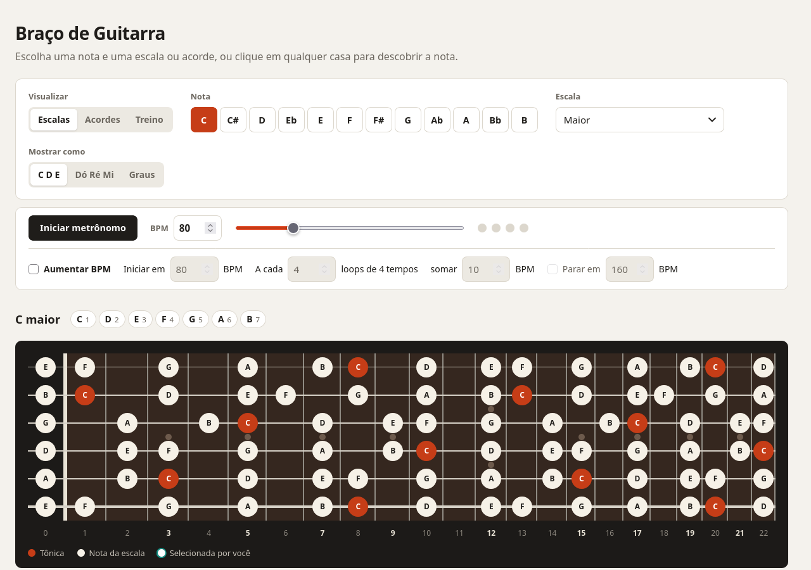 | 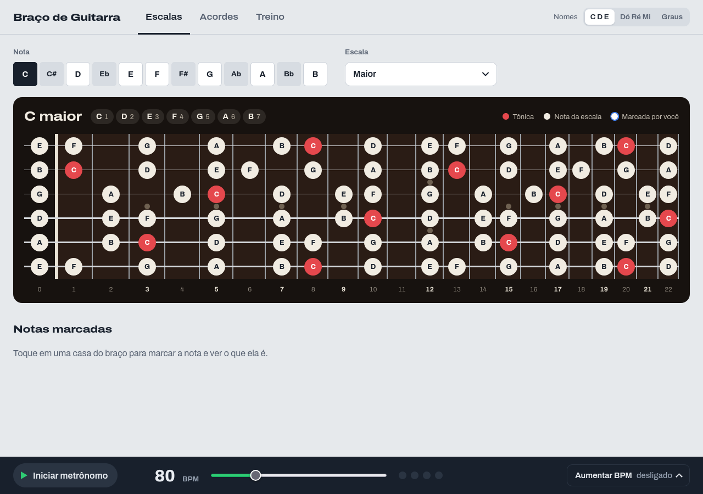 |

### Configuração do treino de acordes, desktop

| Antes | Depois |
| --- | --- |
| 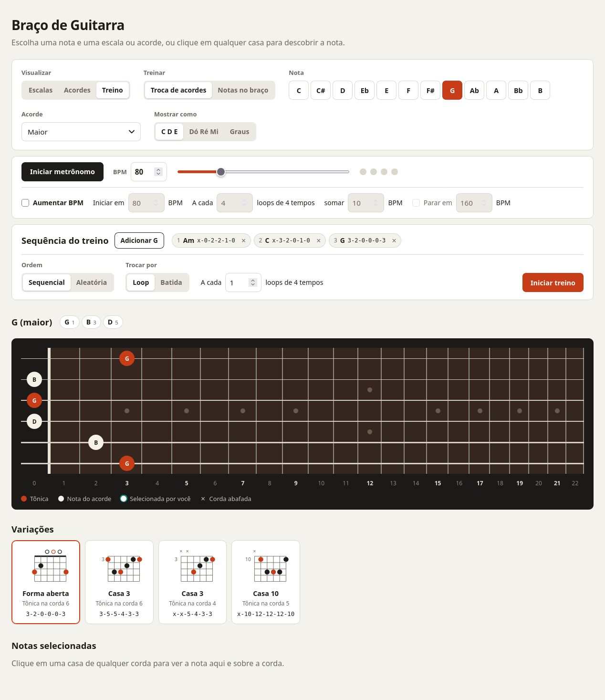 | 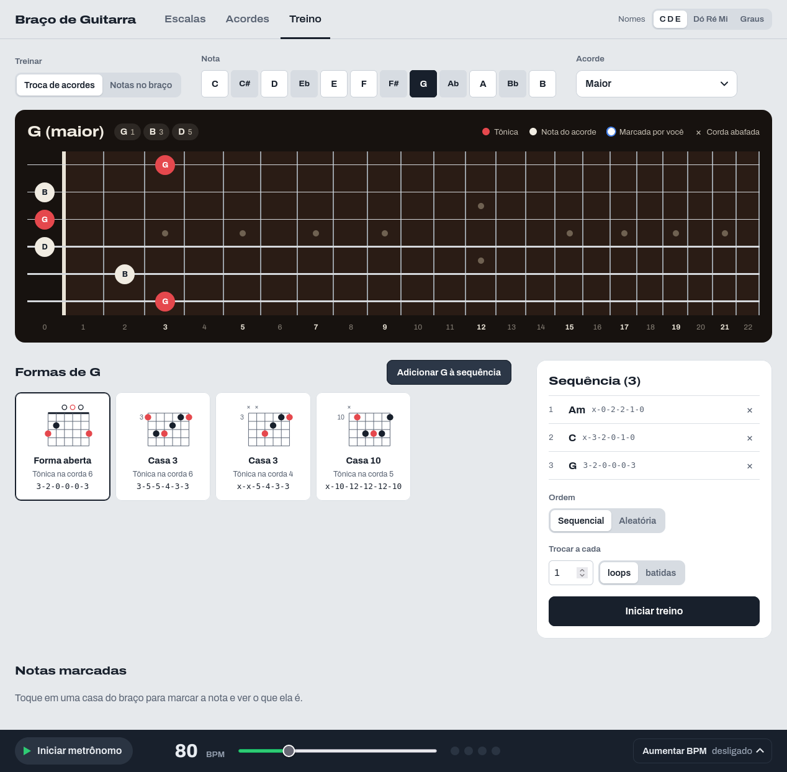 |

### Treino de acordes rodando, desktop

| Antes | Depois |
| --- | --- |
| 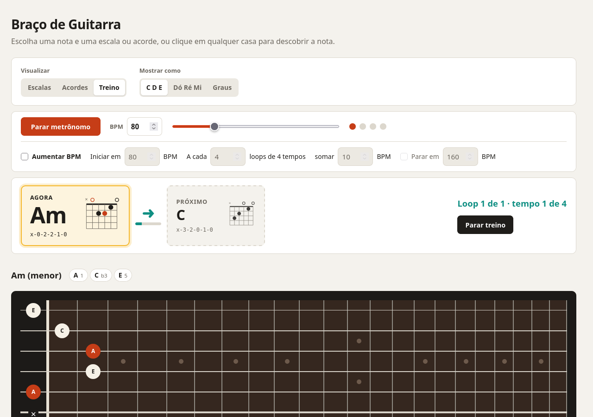 | 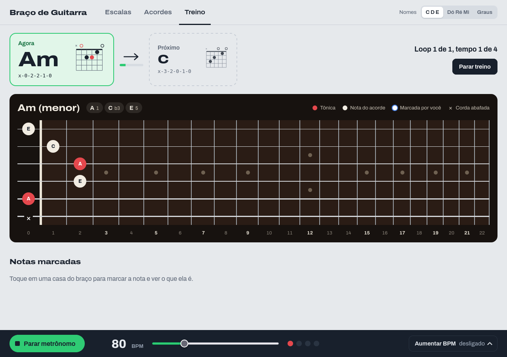 |

### Treino de notas rodando, desktop

| Antes | Depois |
| --- | --- |
| 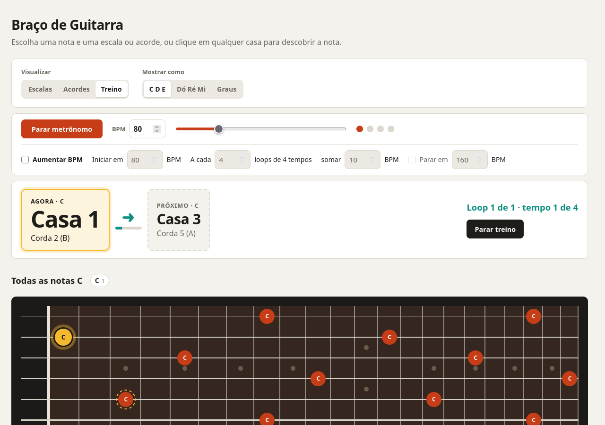 | 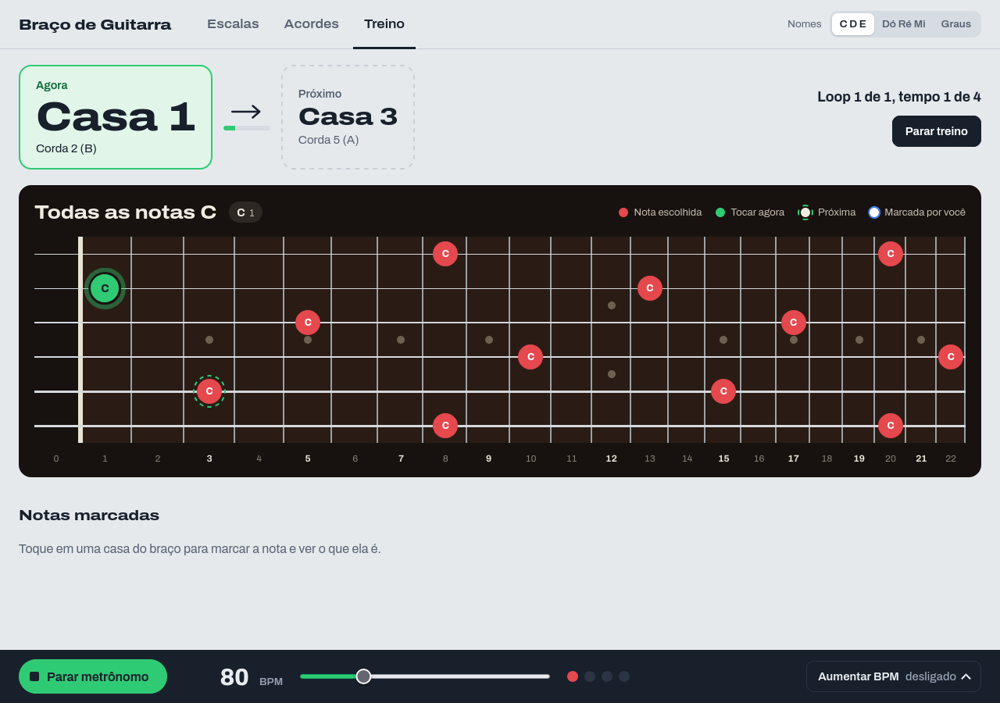 |

### Celular

| Antes, Escalas | Depois, Escalas | Antes, treino | Depois, treino |
| --- | --- | --- | --- |
| 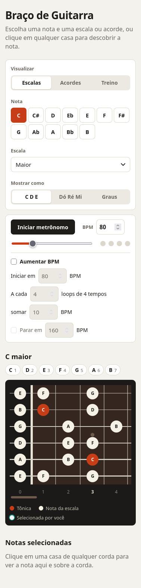 | 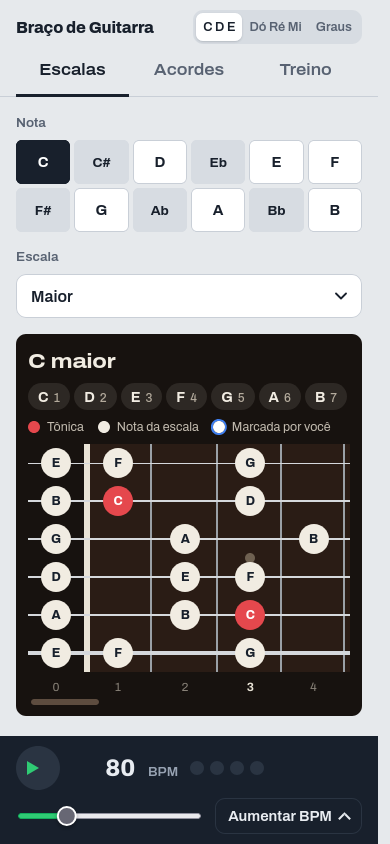 | 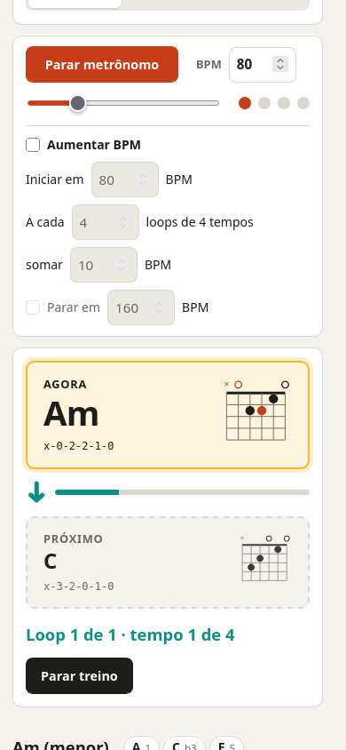 | 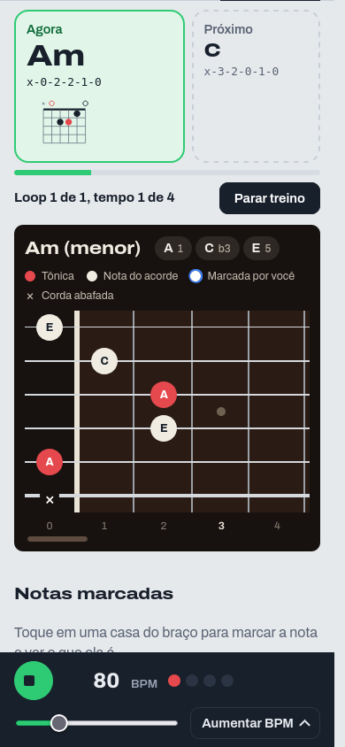 |

### Aumentar BPM, novo painel

| Desktop | Celular |
| --- | --- |
| 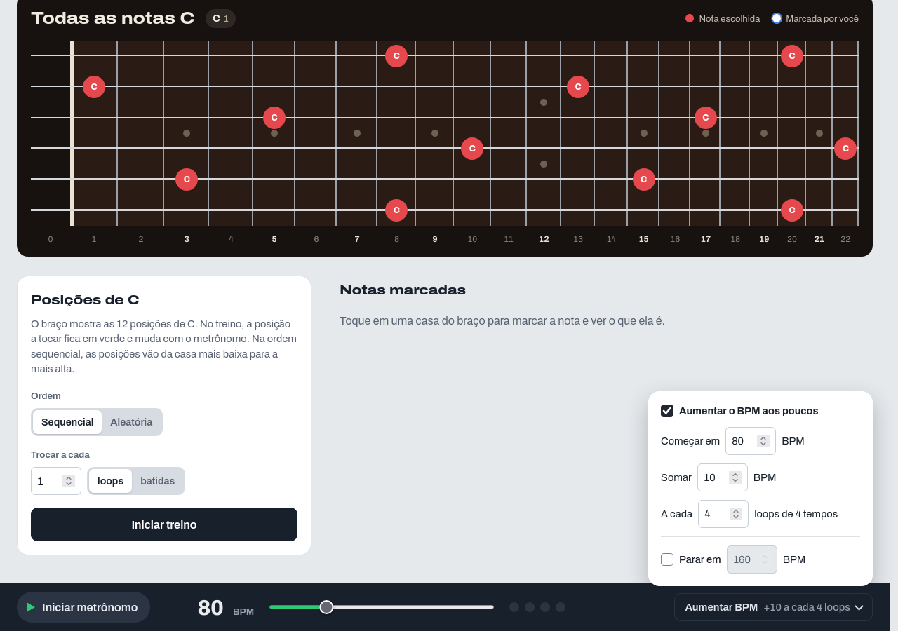 | 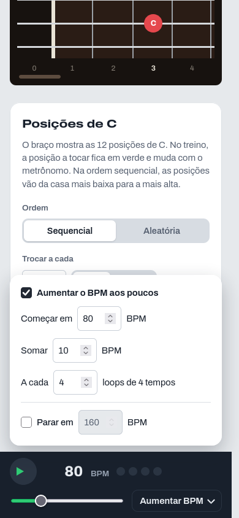 |

## O que mudou no código

- **`index.html`:** reorganizado nas cinco zonas. Os IDs usados pelo JavaScript foram mantidos, exceto:
  - o invólucro `#training` saiu;
  - `#training-loops-field` e `#training-beats-field` saíram;
  - os rótulos `#training-current-label` e `#training-next-label` saíram.
- **`script.js`:**
  - Em `render()`, o `<body>` ganha os atributos `data-mode`, `data-view` e `data-running`, que o CSS usa para distribuir os painéis abaixo do braço.
  - A escolha some durante o treino, e o botão de adicionar acompanha as formas.
  - Novo `renderRampSummary()` para o resumo do aumento de BPM.
  - Ao iniciar o treino, a página rola até os cartões Agora e Próximo.
  - A lógica de teoria musical, do metrônomo e do treino não mudou.
- **`style.css`:** reescrito com os novos tokens, as zonas, o rodapé fixo e o ajuste para celular.
- **Fonte:** a Archivo vem do Google Fonts. Sem internet, o navegador usa a fonte do sistema e o layout continua funcionando.

## Verificação

- 46 testes automatizados no Firefox headless, sem erros no console. Cobrem:
  - os três modos e os dois treinos;
  - a ordem sequencial e a aleatória;
  - a parada pelo metrônomo, pela troca de aba e pelo limite de BPM;
  - o resumo do Aumentar BPM;
  - o rodapé no celular.
- Testes de layout novos:
  - com o treino rodando, os cartões e o braço inteiro cabem acima do rodapé em 1400×1100;
  - "Notas marcadas" fica alinhada ao braço.
- Medições do braço (tabela do início) feitas com o mesmo script nas duas versões.
- **Não verificado:**
  - Chrome e Safari;
  - leitor de tela real (só os nomes acessíveis foram conferidos no código);
  - o modo de movimento reduzido.

## Próximos passos possíveis

- **Lembrar preferências:** guardar a última aba, a nota e o BPM no navegador, para o estudo continuar de onde parou.
- **Tela de treino focada:** um modo que esconde tudo menos Agora, Próximo, o braço e o metrônomo, com letras ainda maiores para ler de longe.
- **Atalhos de teclado:** espaço para iniciar e parar o metrônomo, e setas para mudar o BPM.
- **Formas no celular:** testar uma faixa com rolagem horizontal, para economizar altura.
